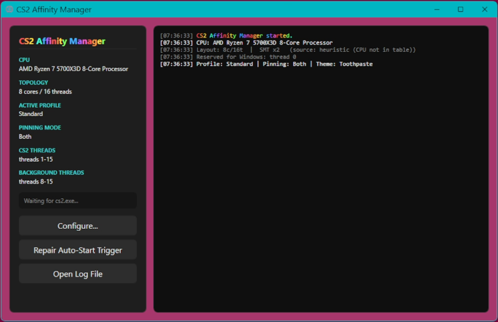
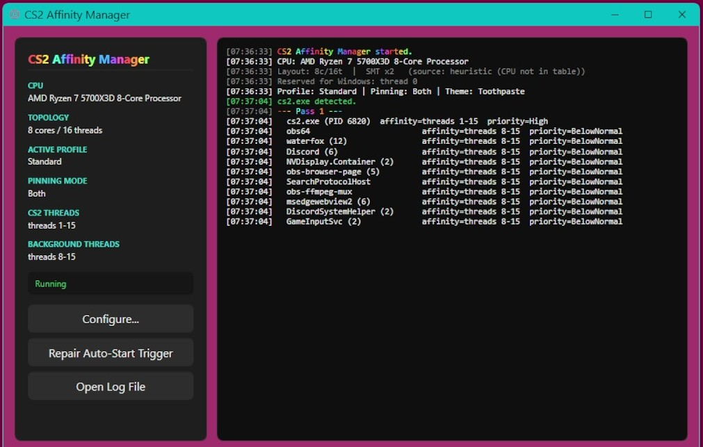
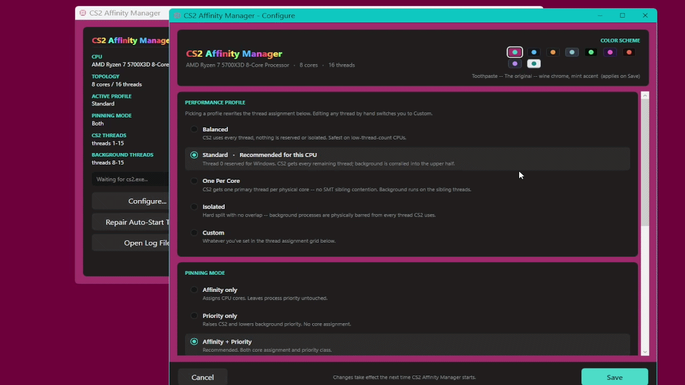

# CS2 Affinity Manager

Left to its own devices, Windows lets everything on your PC compete for the same CPU threads, and CS2 is just another program in the queue. Affinity Manager moves the heaviest background programs onto the threads CS2 uses least, so they stay out of its way.

It's configured once during install. After that it starts on its own when CS2 launches and closes when the game does.



## What it does

Every 5 minutes it checks which programs are eating the most CPU, takes the worst 10, and shifts them onto threads CS2 isn't relying on. It also raises CS2's priority and lowers theirs, so CS2 gets CPU time first when they compete for it.

How much of the CPU CS2 gets depends on which profile you pick. Usually it's everything except thread 0.

Thread 0 is always left alone. Windows schedules its own work there no matter what you do, and reserving it is a known improvement on its own, mainly to 1% lows rather than average framerate.

It also checks what kind of CPU you have before deciding any of this. How many cores, whether some of them are the slower kind Intel puts on their newer chips, whether they're split into separate groups like AMD does. An 8 core Ryzen and a 24 core Intel get different settings as a result.



## Profiles

Pick one yourself or use the one it suggests for your CPU.

| Profile | What it does |
|---|---|
| Balanced | Doesn't move anything. For CPUs without many threads to spare. |
| Standard | CS2 can use everything except thread 0. Background programs get pushed into the top half. |
| One Per Core | CS2 gets one thread per core instead of both. Background programs get the other one. |
| Isolated | Background programs are locked out of CS2's threads completely. |
| Custom | You pick the threads yourself. |

Intel chips that have both fast and slow cores get an extra option that puts all the background stuff on the slow ones. AMD chips built in two halves get one that keeps the game on the first half, which on X3D chips is the half with the extra cache.

You can also choose whether it moves programs around, changes their priority, or both. There are some color themes as well.



## Is it safe

It changes two things about a program: which CPU threads it's allowed to use, and how important Windows thinks it is. You can change both of those yourself in Task Manager, and Affinity Manager goes through the same part of Windows to do it. It doesn't read or write the game's memory, doesn't inject anything into it, and doesn't touch any files.

Nothing it does is permanent. Those settings only exist while a program is open, so closing it or restarting your PC puts everything back to normal. It doesn't install a driver or a service and doesn't touch the registry.

About 250 programs are on a list it won't touch under any circumstances. All the anti-cheat ones (VAC, FACEIT, EAC, BattlEye), Windows system processes, graphics and audio drivers, antivirus, VPNs. Anything running out of `C:\Windows` gets skipped too. You can add your own entries to the list.

Setup turns on a Windows logging option so Task Scheduler can tell when `cs2.exe` opens. That's the only change it makes to your system, and uninstalling removes the scheduled task.

## Installing

Grab the installer from [Releases](../../releases). It'll check your CPU during setup and suggest settings, or you can skip that and do it yourself.

If the auto start stops working there's a **Repair Auto-Start Trigger** button in the main window. Windows updates sometimes wipe scheduled tasks.

If you'd rather build it yourself, see [BUILD.md](BUILD.md).

## Config and logs

```
%LOCALAPPDATA%\CS2-AffinityManager\
    config.json
    affinity-YYYY-MM-DD.log
```

The log pane shows what's being moved where as it happens. **Open Log File** opens today's.

## License

MIT, see [LICENSE](LICENSE).
